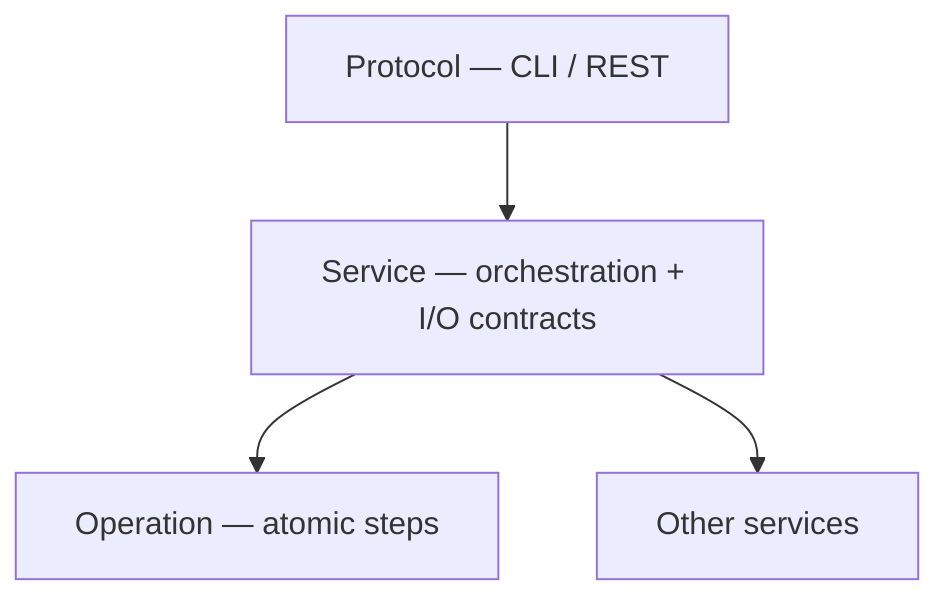

# Architecture conventions

Layering rules for OpenQuantMaster: how **Operation**, **Service**, and **Protocol** relate, and what must not cross layer boundaries.

## Layers

### Operation

Smallest unit of work: one algorithm or one external boundary call.

- Prefer **pure** functions (deterministic, no hidden I/O) **or** a **single** API/DB/file/network call.
- Return `OperationResult` (`success`, `data`, `error` as the shared `Error | None`). Convert expected boundary failures into this result instead of raising them.
- **Forbidden inside Operations:** calling Services, Protocol adapters, or other Operations that themselves orchestrate multi-step workflows.
- Multi-step sequences, retries, branching, and transaction boundaries belong in a **Service**.

### Service

Programmable application API: orchestrates Operations and/or other Services.

- Explicit **Pydantic** config / input / output models (JSON Schema–exportable for CLI and future REST).
- Entry shape: `await Service(cfg).run({...})` → `ServiceResult` (`success`, `data`, `error` as the shared `Error | None`, optional `duration_seconds` on the call envelope).
- May **compose** other Services; keep dependency direction acyclic.
- Own side effects and consistency (e.g. call exchange, persist state).
- A Service may be thin today (mostly one boundary) while still being the **public** unit Protocol calls; extract Operations when a step is reused or the workflow grows multi-step.

### Protocol (CLI / REST)

Adapters that expose Services to humans and automation.

- Parse args / HTTP, invoke the appropriate **Service**, format results.
- **Must not** call **Operations** directly — always go through a **Service** so contracts stay centralized.
- No business logic beyond parsing, auth, and response mapping.
- CLI frameworks (e.g. Click) belong here only — never inside Services or Operations.

## Dependency rules

Allowed call direction (caller → callee):

| Caller | May call |
|--------|----------|
| Protocol (CLI, REST) | Service |
| Service | Operation, other Service |
| Operation | stdlib, pure helpers, **one** I/O boundary — not Service or Protocol |

**Hard rules:**

1. **Protocol → Service → Operation** (Protocol never skips Service to reach Operation).
2. **Services may compose Services**; avoid cycles — inject dependencies at construction time.
3. **Protocol must NOT call Operations directly.**

## Anti-patterns (forbidden)

| Anti-pattern | Why |
|--------------|-----|
| **Click (or other CLI framework) inside Services or Operations** | CLI belongs in **Protocol** only |
| **Business logic in Protocol** beyond parsing, auth, and response mapping | Duplicates Service contracts |
| **Multi-step workflows inside Operations** | Use a Service |
| **Protocol calling Operations directly** | Breaks the single public contract surface |

## Cross-links

- Index: [`README.md`](./README.md)
- Testing against public surfaces: [`testing.md`](./testing.md)
