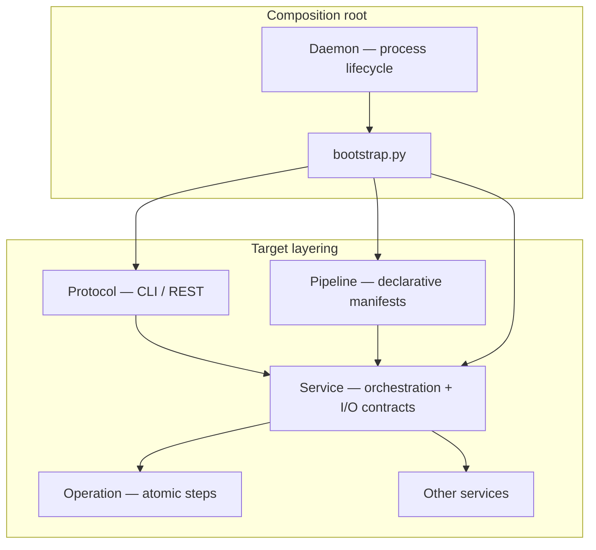
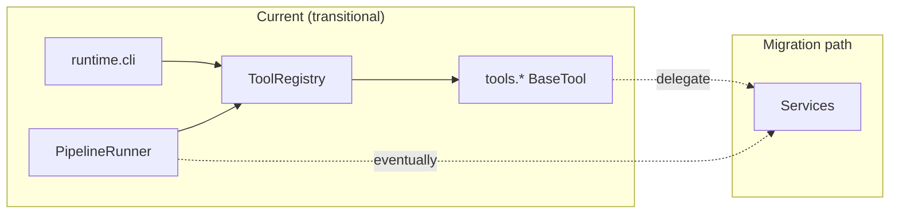
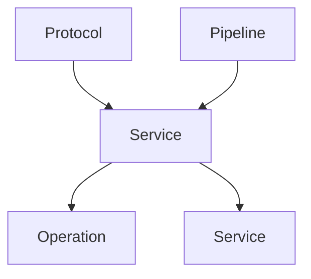

# Architecture conventions

Layering rules for OpenQuantMaster: how **Operation**, **Service**, **Pipeline**, and **Protocol** relate, and what must not cross layer boundaries.

## Current vs target

Today the runtime is tool-centric: YAML pipelines invoke tools through `ToolRegistry`, and the CLI exposes `tool` commands. The **target** model keeps pipelines and CLI as thin adapters while business logic lives in **Services** built from **Operations**.

| Aspect | Current | Target |
|--------|---------|--------|
| CLI entry | `python -m runtime.cli tool …` | Same CLI, implemented as **Protocol** → **Service** |
| Pipelines | YAML `tool:` steps via `PipelineRunner` + `ToolRegistry` | YAML **`service:`** steps orchestrating **Services** |
| Business logic | Mostly inside `tools/` | **Services** composing **Operations** |
| Composition | `bootstrap.py` wires store, bus, registry, runner | Unchanged: **bootstrap** remains the only composition root |

**Transitional note:** `PipelineRunner` still resolves steps through `ToolRegistry`. Tools may temporarily **delegate** to Services; new orchestration should land in Services, not grow tool internals.

## Layers

### Operation

Smallest unit of work: one algorithm or one external boundary call.

- Prefer **pure** functions (deterministic, no hidden I/O) **or** a **single** API/DB/file/network call.
- **Forbidden inside Operations:** calling Services, Pipelines, CLI, daemon/bootstrap lifecycle, or other Operations that themselves orchestrate multi-step workflows.
- Multi-step sequences, retries, branching, and transaction boundaries belong in a **Service**.

### Service

Programmable application API: orchestrates Operations and/or other Services.

- Define explicit **Pydantic** input and output models (types must be **JSON Schema–exportable** for manifests, CLI, and future REST).
- Services may **compose** other Services; keep dependency direction acyclic (see below).
- Services own side effects and consistency (e.g. read config once, call exchange, persist state).

### Pipeline

Declarative workflow over **Services** (target).

- Manifests describe *what* runs and in what order; they do not embed business rules.
- **Target:** pipeline steps reference `service:` (name + inputs), not tool implementation details.
- **Today:** manifests still use `tool:`; runner uses `ToolRegistry` until the pipeline manifest and runner are migrated.

### Protocol (CLI / REST)

Adapters that expose Services to humans and automation.

- **CLI** (`runtime.cli`): parse args, load config via bootstrap context, invoke the appropriate **Service**, format results (JSON/text).
- **REST** (future): same Service calls behind HTTP handlers; no duplicate business logic in handlers.
- Protocol layers **must not** call **Operations** directly — always go through a **Service** so contracts stay centralized.

### bootstrap + Daemon

- **`bootstrap.py`** is the **only composition root**: construct config, `StateStore`, event bus, registries, scheduler, `PipelineRunner`, notifiers, and Service instances. Nothing else should `new` the full runtime graph.
- **Daemon** owns **process lifecycle** (start/stop, signal handling, scheduled pipeline execution). It uses bootstrap output; it does not become a grab-bag of business entrypoints.

## Dependency rules

Allowed call direction (caller → callee):

| Caller | May call |
|--------|----------|
| Protocol (CLI, REST) | Service |
| Pipeline (runner) | Service |
| Service | Operation, other Service |
| Operation |stdlib, pure helpers, **one** I/O boundary — not Service/Pipeline/Protocol |

**Hard rules:**

1. **Protocol → Service → Operation** (Protocol never skips Service to reach Operation).
2. **Pipeline → Service → (Operation | Service)** (Pipeline never invokes Operations or tools’ private helpers directly in the target model; during transition, tool entrypoints should thin-wrap Services).
3. **Services may compose Services**; avoid cycles — prefer dependency injection from bootstrap.
4. **Protocol and Pipeline must NOT call Operations directly.**

## Anti-patterns (forbidden)

| Anti-pattern | Why |
|--------------|-----|
| **God-object `RuntimeService`** mixing daemon lifecycle, scheduling, and every business use case | Violates single responsibility; untestable; blocks Protocol/Pipeline clarity |
| **Click (or other CLI framework) inside Services or Operations** | CLI belongs in **Protocol** only |
| **Business logic in Protocol** beyond parsing, auth, and response mapping | Duplicates Service contracts |
| **Multi-step workflows inside Operations** | Use a Service |
| **Second composition root** (modules that bootstrap the full stack ad hoc) | Use `bootstrap()` |

## Future work (out of scope for this doc slice)

Not required to implement before following the rules above; tracked for later slices:

- **Service registry** — discover and register Services alongside (or replacing) tool discovery for pipeline/CLI resolution.
- **Pipeline manifest `service:`** — YAML and schema changes plus `PipelineRunner` updates to invoke Services by name.
- **REST adapter** — HTTP Protocol layer sharing the same Pydantic Service models as CLI.

## Cross-links

- Index: [`README.md`](./README.md)
- Testing against public surfaces: [`testing.md`](./testing.md)
- Agent entrypoint: [`skills/core/AGENT_GUIDE.md`](../../skills/core/AGENT_GUIDE.md)
