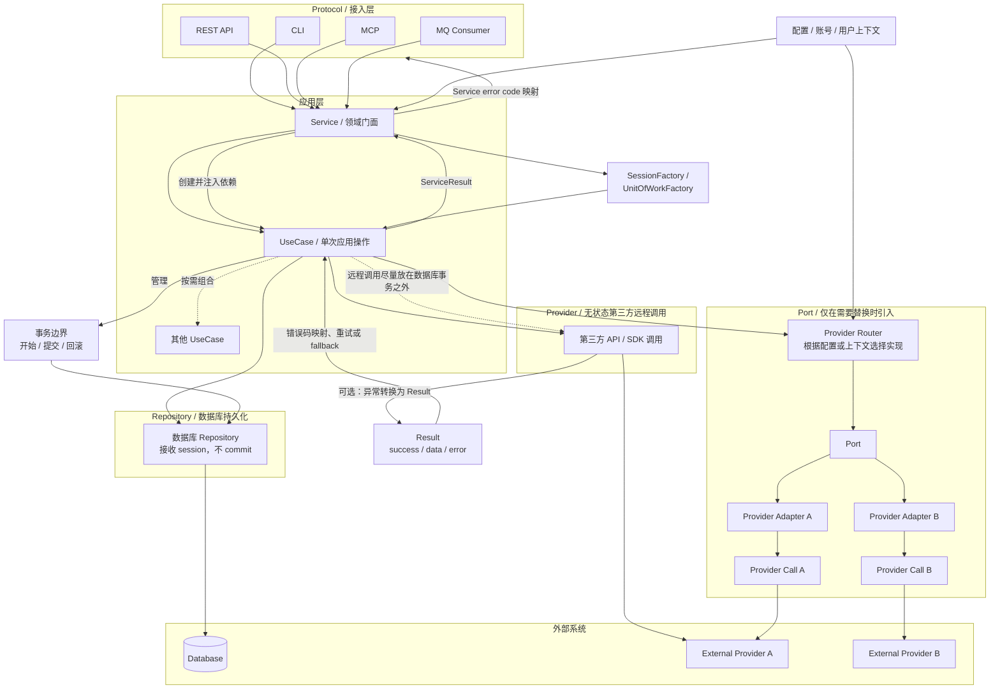

# Architecture conventions

This document defines a lightweight layered architecture. Do not introduce Ports or other abstractions solely to match an architectural diagram; add them when a concrete requirement justifies them. Repositories here are concrete database-access functions, not an abstract repository pattern.

## Dependency direction

```text
Protocol → Service → UseCase → Provider / Repository / Port
```



## Folder organization

Keep the top-level structure small. Create optional directories only when the corresponding abstraction is actually used.

```text
project_root/
├── src/
│   ├── protocols/          # CLI、REST、MCP、MQ 等接入适配器
│   │   └── cli/
│   ├── services/           # 对外门面、依赖所有权与装配
│   ├── use_cases/          # 单次应用操作及业务流程编排
│   ├── providers/  # 无状态第三方远程调用（HTTP、API、SDK）
│   ├── repositories/       # 数据库读写；接收 session，不 commit
│   ├── ports/              # 可选：需要替换的外部能力接口
│   ├── adapters/           # 可选：Port 的具体实现与 Provider 适配
│   ├── models/             # Result、Error 和跨层共享的核心领域数据结构
│   ├── utils/              # 可选：通用、无副作用的函数与装饰器
│   └── config.py           # 配置模型与加载
└── tests/
    ├── services/
    ├── use_cases/
    ├── providers/
    └── repositories/
```

The names `entrypoints` and `interfaces` may replace `protocols` when they better describe the application. The dependency rules matter more than the directory names.

## Model placement

`models/` contains the common Result/Error types and stable domain or core data structures genuinely shared across layers. It is not a catch-all location for every Pydantic class. The distinction is semantic, not technical: type annotations, validation, and inheriting from `BaseModel` describe a class's structure, not whether it represents a domain concept.

Service input/output models are application API contracts, not domain models by default. They describe the input and output of one application operation, including interface-specific defaults and validation. For example, a `limit <= 5000` rule on `OHLCVInput` is a constraint of that Service API, not a universal rule about market data. Define these models next to the Service that owns them, for example in `services/ohlcv.py`, and let Protocols import them from there. A UseCase may accept and return those same models, or define its own models next to the UseCase when its application contract differs.

By contrast, a domain or core model represents a stable business concept independently of any single operation or transport. For example, a `Bar` model shared by market-data, indicator, and strategy code describes the business data itself rather than the parameters of one request. Move a model into `models/` only when it has this kind of stable meaning and is genuinely shared by multiple Services or UseCases. Merely appearing in a Service response does not make it a domain model.

Repositories are the persistence boundary and may return ORM entities or domain/core models directly; translating persisted rows into those models is their responsibility. They must not return Service input/output models. Providers remain independent of application models as described below.

Do not add long `models/__init__.py` re-export lists merely to collect request and response classes in one place.

## Generic utilities

Use `src/utils/` for small, reusable, domain-agnostic functions and decorators: retry/backoff decorators, time parsing, text normalization, sorting/grouping helpers, and similar "lodash-like" tools.

- Utilities have no configuration, environment, network, database, or global-state dependencies. A utility may wrap an effectful call, as a retry decorator does, but the caller supplies the effect and policies such as attempts, backoff, and retryable errors; application retry policy still belongs to the UseCase.
- `utils/` must not import Services, UseCases, Providers, Repositories, or domain models. It sits below all application layers.
- Name modules by capability, for example `utils/retry.py` or `utils/time.py`; do not create a catch-all `common.py`.
- Keep a helper next to its only caller while it is provider- or domain-specific. Promote it to `utils/` only when it is generic and actually reused.

## Protocol

Protocols are adapters such as CLI, REST API, MCP, and MQ Consumer.

- Deserialize and validate external input, invoke the appropriate Service, and serialize its result into the protocol response.
- Handle authentication and protocol-level errors.
- Map Service error codes to the Protocol's own external error specification; do not expose Service codes or Provider codes by default.
- Do not implement business workflows or call UseCases, Providers, or Repositories directly.

A Protocol owns transport-specific parsing, rendering, and error mapping. Configuration is loaded at the composition boundary and passed to the Service:

```python
_CLI_ERROR_CODES = {
    "action_rejected": "ACTION_REJECTED",
    "action_unavailable": "ACTION_UNAVAILABLE",
}


@click.command()
@click.option("--value", required=True)
def execute_command(value: str) -> None:
    config = load_config()
    service = ApplicationService.from_config(config)
    result = asyncio.run(service.execute(ExecuteInput(value=value)))

    if not result.success:
        code = _CLI_ERROR_CODES.get(result.error.code, "ACTION_FAILED")
        raise click.ClickException(f"{code}: {result.error.message}")
    click.echo(json.dumps(result.data))
```

Other Protocols follow the same shape but maintain independent mappings for their own specifications. Protocols are also the final boundary for uncaught exceptions; see **Result, ServiceResult, and error conversion** for unknown-error and stack-trace handling.

## Service

A Service is the public facade for a domain or a group of related application capabilities.

- Expose multiple related operations and group their UseCases.
- Own the configuration required by those UseCases.
- Own connection factories and other shared dependencies.
- Construct UseCases and supply their configuration or dependencies; keep public Service methods thin, normally delegating to a UseCase.
- Do not implement third-party API calls or own database transaction boundaries.

Each layer owns its configuration contract. The Service converts its own configuration into the configuration required by each UseCase instead of passing a broad application-wide configuration object through every layer.

```python
class ApplicationService:
    def __init__(
        self,
        config: ApplicationServiceConfig,
        execute_action: BaseUseCase,
        query_status: BaseUseCase,
    ):
        self.config = config
        self._execute_action = execute_action
        self._query_status = query_status

    @classmethod
    def from_config(cls, config: ApplicationServiceConfig):
        return cls(
            config=config,
            execute_action=ExecuteActionUseCase(config.execute_action),
            query_status=QueryStatusUseCase(config.query_status),
        )

    async def execute(self, request: ExecuteInput) -> ServiceResult:
        return await self._execute_action.run(request)

    async def status(self, request: StatusInput) -> ServiceResult:
        return await self._query_status.run(request)
```

This example constructs UseCases directly inside `ApplicationService.from_config()` because they are concrete application dependencies. A dependency-injection container is not required.

## UseCase

A UseCase encapsulates one complete application action behind a standard `run()` method.

- Inherit `BaseUseCase`; the base class implements `run()` and delegates application logic to the subclass's `_run()` implementation.
- Own business rules, workflow orchestration, and the mapping of lower-level errors to application errors.
- Call concrete Providers and Repositories directly. These functions are not injected or abstracted; only session/client dependencies whose lifecycle is owned by an upper layer may be supplied.
- Accept the UseCase's own configuration through the constructor. Also accept other UseCases, SessionFactories, or Ports only when composition, transactions, or replaceable external capabilities require them.
- Own application policies such as retries, cross-provider fallback, and compensation.
- Own database transaction boundaries.
- Do not read global configuration, locate Services, or depend on Protocol frameworks.
- Prefer typed input and output models over internal `dict[str, Any]` contracts. Protocol adapters handle conversion to and from transport representations. Define these contracts according to **Model placement**.

Services and composed UseCases depend on the `BaseUseCase` abstraction rather than concrete UseCase types. The base `run()` method provides consistent timing and may add logging or tracing. It does not convert arbitrary exceptions into Results:

```python
class BaseUseCase(ABC):
    async def run(self, inputs) -> ServiceResult:
        started = time.perf_counter()
        try:
            result = await self._run(inputs)
        finally:
            duration_seconds = time.perf_counter() - started
            # Record duration through the selected observability mechanism.

        result.duration_seconds = duration_seconds
        return result

    @abstractmethod
    async def _run(self, inputs) -> ServiceResult:
        ...
```

An unexpected exception raised by UseCase or Service code propagates to the Protocol. A Provider's Result-returning variant is different: it deliberately converts all ordinary exceptions from that remote call, including unclassified failures, into a `Result`; see **Result and error conversion**.

### Basic UseCase example

The Provider below is the concrete, stateless third-party call defined in the Provider section, not an interface or injected adapter. This example uses its Result-returning variant and maps only explicitly recognized error codes:

```python
from providers.remote import call_remote_api_result


class ExecuteActionUseCase(BaseUseCase):
    def __init__(self, config: ExecuteActionConfig):
        self._config = config

    async def _run(self, inputs: ExecuteInput) -> ServiceResult:
        result = await call_remote_api_result(
            token=self._config.token,
            payload={"value": inputs.value},
            timeout_seconds=self._config.timeout_seconds,
        )
        if not result.success:
            if result.error.code == "provider_rejected":
                return ServiceResult.from_error(
                    "action_rejected",
                    "The action was rejected",
                    result.error.exception,
                )
            if result.error.code in {"provider_timeout", "provider_unavailable"}:
                return ServiceResult.from_error(
                    "action_unavailable",
                    "The action is temporarily unavailable",
                    result.error.exception,
                )
            return ServiceResult.from_error(
                "action_failed",
                "The action could not be completed",
                result.error.exception,
            )

        return ServiceResult(success=True, data={"value": result.data})
```

The default branch handles `unknown`, recognized codes that need no special policy, and codes introduced later. A UseCase may instead call the original throwing Provider when it does not need error-code-based decisions; exceptions then propagate to the Protocol.

Tests may monkeypatch the concrete Provider or third-party SDK. Providers are suitable patch targets because they are deliberately thin wrappers around HTTP or other protocols: their parameters and responses are stable, their remote-call details are hidden, and their simplicity makes disruptive refactoring unlikely. A mocked Provider returns its documented provider-level output, including any provider-local normalization it owns; application workflows and request-specific shaping remain real UseCase behavior under test. Do not introduce a Provider interface solely for testing. Avoid patching internal helper functions or other internal objects whose structure may change during refactoring.

When multiple providers require replacement, the Service owns the selected Port and supplies it to the relevant UseCase. A test Port may then be supplied through the Service. Until that requirement exists, call concrete Providers directly.

### UseCase composition example

A parent UseCase may compose other UseCases when each child represents a complete, independently valid application action and no shared database transaction is required. Composed UseCases are constructor dependencies:

```python
class CompositeUseCase(BaseUseCase):
    def __init__(self, first: BaseUseCase, second: BaseUseCase):
        self._first = first
        self._second = second

    async def _run(self, inputs: CompositeInput) -> ServiceResult:
        first_result = await self._first.run(inputs.first)
        if not first_result.success:
            return ServiceResult(
                success=False,
                error=first_result.error,
            )

        return await self._second.run(
            SecondInput(value=first_result.data["value"])
        )
```

The steps inside a transaction are Repositories or internal steps composed from Repositories. They receive the current session and never commit independently.

To compose multiple transactional UseCases atomically, each child exposes an internal `execute_in_transaction(session, inputs)` method. Its public `run()` may use that same method for standalone execution, but the parent must not call the child's public `run()`, because that would create an independent transaction. The outermost composite UseCase owns the shared session and performs the only commit:

```python
class CompositeTransactionalUseCase(BaseUseCase):
    def __init__(
        self,
        config: CompositeTransactionalConfig,
        session_factory,
        first: FirstTransactionalUseCase,
        second: SecondTransactionalUseCase,
    ):
        self._config = config
        self._session_factory = session_factory
        self._first = first
        self._second = second

    async def _run(self, inputs: CompositeInput) -> ServiceResult:
        async with self._session_factory() as session:
            try:
                first = await self._first.execute_in_transaction(session, inputs.first)
                second = await self._second.execute_in_transaction(session, first)
                await session.commit()
                return ServiceResult(success=True, data=second)
            except SQLAlchemyError as exc:
                await session.rollback()
                return ServiceResult.from_error("database_error", str(exc), exc)
```

Each child's `execute_in_transaction()` calls its Repositories and returns an ordinary value or model. Its standalone `_run()` may open a session, call the same method, and commit. This provides both independent execution and atomic composition without nested commits.

UseCase composition means object composition and dependency injection; it does not require the GoF Composite pattern.

## Provider

Providers live in `providers/`. They are concrete, stateless functions for third-party API, HTTP, or SDK calls. They abstract away transport and SDK details; they are not abstract interfaces, long-lived service objects, or dependency-injection service providers, and they do not require dependency injection. Database access is not a Provider; it belongs to Repositories. Providers remain concrete monkeypatch targets in tests.

### Third-party Provider calls

- Accept every value needed for the call, including keys and tokens, as explicit parameters.
- Keep fixed endpoint URLs inside the Provider. Do not require callers to pass endpoints that are part of the provider's protocol definition.
- Do not read configuration, select users or accounts, choose providers, or manage connection state.
- Hide HTTP and SDK details from callers.
- Leave credential, account, connection, and provider lifecycle management to upper layers.
- Return ordinary values and throw exceptions by default. Do not make every Provider return `Result` directly.
- Expose a Result-returning variant through a decorator when a caller needs error-code-based retry, fallback, or mapping. A Provider may provide only a Result-returning form when that is clearly more appropriate, but the throwing form plus derived Result variant is preferred.

```python
_REMOTE_ENDPOINT = "https://provider.example/api/action"


async def call_remote_api(
    *,
    token: str,
    payload: dict,
    timeout_seconds: float,
) -> dict:
    async with httpx.AsyncClient(timeout=timeout_seconds) as client:
        response = await client.post(
            _REMOTE_ENDPOINT,
            headers={"Authorization": f"Bearer {token}"},
            json=payload,
        )
    response.raise_for_status()
    return response.json()


call_remote_api_result = as_call_result(
    call_remote_api,
    map_error=map_remote_error,
)
```

Callers may choose either form. The throwing form avoids repetitive success checks and lets exceptions propagate naturally. The Result form converts both classified and unclassified ordinary exceptions from the remote call into returned Results. Start with `unknown` for all failures and add specific mappings only when a caller needs them.

### Provider output and provider normalization

Providers do not depend on Service input/output models or core domain models. Their default output is plain data such as `dict`, `list`, or SDK records.

A structured transport type is justified when plain data would be ambiguous or unsafe to consume—for example, a provider response with many similarly named fields whose types matter. In that case define a small dataclass, `TypedDict`, or Pydantic model **in the Provider module**, mirroring the provider's wire fields and types. It is a typed view of that provider response, not a shared domain model: no application behavior, no cross-provider abstraction, and no re-export from `models/`. Callers import it from the concrete Provider module only when they need its type information. Do not create such a class for every response; a clear `dict` is enough for most calls.

A Provider may perform lightweight, provider-local transformation when it is part of hiding that provider's details: field renaming, timestamp parsing to one canonical representation, deterministic identifier derivation, or response filtering required by the provider's API semantics. Keep it when all of the following hold:

- Every caller needs the same transformation; otherwise keep the richer response and let callers shape it.
- It depends only on the Provider's inputs and provider response, not on configuration, global state, or other providers.
- It does not implement caller-specific or business policy, such as keyword rules, cross-source deduplication, ranking, or aggregation.
- It preserves information callers may reasonably need; do not trim a rich provider response to one caller's current view.

This avoids repeating identical conversion at every call site without turning the Provider into a workflow. When the transformation is more than a few lines, implement it as a pure function in the same provider module, or an adjacent provider-specific helper, and call it from the Provider so it can be tested without network access.

The Provider's documented output, including these normalizations, is its mock contract. Tests that replace the Provider return that normalized output; tests for the transformation itself patch the external SDK or call the pure helper directly. Cross-provider or request-specific shaping still belongs to the UseCase.

### Client construction and connection lifetime

The default is to construct and close an HTTP/SDK client within the Provider call. Repeated setup can be factored into a private helper, but that helper must not return a module-global singleton. Do not use a default client, default credentials, or mutable module state to make parameters optional: different accounts, credentials, sandbox modes, and products must not leak between calls, and tests must remain isolated.

Introduce client reuse only for a concrete latency or resource requirement. In that case, the Service owns the long-lived client or client factory and its shutdown, supplies it to the UseCase, and the Provider receives the client as an explicit parameter. The Provider does not silently cache or close a client owned by an upper layer. A client factory is not a Port; do not introduce a Port solely for connection reuse.

## Repository

Repositories live in `repositories/`. They are concrete database read/write functions, or small modules grouping those functions, not interfaces or an abstract repository framework.

- Accept the current database session as a parameter.
- Execute database reads or writes without opening or committing a transaction themselves.
- Return ORM entities, domain/core models, or ordinary values as appropriate. Mapping persisted rows into models belongs to the Repository; return models directly instead of requiring every caller to convert dictionaries.
- Throw ORM exceptions by default. The UseCase handles expected database failures after rollback; Repositories do not return `Result` or `ServiceResult`.
- Name Repositories after domain capabilities using `create_<entity>`, `delete_<entity>`, `query_<entity>`, or `update_<entity>` rather than SQL-oriented names such as `insert_record`.

```python
async def create_entity(session: AsyncSession, values: dict) -> Entity:
    entity = Entity(**values)
    session.add(entity)
    await session.flush()
    return entity
```

### Repository testing

Do not patch or mock Repositories, database sessions, or their results in Service/UseCase workflow tests. Use a real test database and fixtures or factories to create the required data, then exercise the real queries, constraints, commits, and rollbacks. Providers may still be mocked independently.

Tests that need persistent state are integration tests, even when they use an in-memory database; mark them accordingly. Pure business-logic tests that do not touch persistence remain unit tests.

Isolate each test with its own database/schema or reliable cleanup. Do not rely only on an outer rollback transaction around the code under test, because that can hide incorrect commit and nested-transaction behavior. For transaction isolation, locking, and concurrency behavior, use the same database engine as production: SQLite-only tests cannot demonstrate production row-locking or isolation semantics.

## Result, ServiceResult, and error conversion

Provider and Service errors are different contracts even when they use the same generic Result container:

- A Provider returns `Result` from its Result-returning form, supporting internal decisions such as retry, fallback, and application error mapping.
- A `ServiceResult` describes the outcome of an application capability and may add application-level fields such as duration. Its error codes form the stable application contract.
- A Protocol maps Service error codes to its own external specification. Service error codes are not automatically external protocol error codes.

Use one generic `Result` rather than creating identical `ProviderResult`, `DatabaseResult`, or `MQResult` types for each integration kind. `ServiceResult` may extend `Result` when it needs additional application-level fields. Sharing the container and `Error` data structure does not create a shared error-code namespace: each layer still owns and explicitly maps its codes. Repositories do not use these wrappers; they return models or values and throw ORM exceptions.

```python
@dataclass
class Error:
    code: str
    message: str
    exception: Exception | None = None


@dataclass
class Result:
    success: bool
    data: Any = None
    error: Error | None = None

    @classmethod
    def from_error(cls, code: str, message: str, exception: Exception | None = None):
        return cls(
            success=False,
            error=Error(code=code, message=message, exception=exception),
        )


@dataclass
class ServiceResult(Result):
    duration_seconds: float = 0.0
```

`Error.code` is the stable classification within its owning layer. Do not build a hierarchy of provider-specific exception classes in `providers/base.py` or use exception class names as the caller's branching contract. If a Provider itself must raise an already categorized failure, use at most one generic `ProviderError` carrying `code` and `message`; distinguish `provider_rejected`, `provider_unavailable`, and similar cases by code rather than separate classes. Provider-specific mapping functions remain in the Provider module.

### Throwing and Result-returning forms

A Provider initially needs no error classification: its throwing form lets HTTP/SDK exceptions propagate, and its Result form converts every unclassified ordinary exception to `unknown`. Add a specific mapping only when a caller needs to branch on that failure.

```python
def as_call_result(func, *, map_error=None):
    @wraps(func)
    async def wrapper(*args, **kwargs):
        try:
            data = await func(*args, **kwargs)
            return Result(success=True, data=data)
        except Exception as exc:
            error = map_error(exc) if map_error is not None else None
            if error is None:
                error = Error(code="unknown", message=str(exc), exception=exc)
            return Result(success=False, error=error)

    return wrapper


def map_remote_error(exc: Exception) -> Error | None:
    if isinstance(exc, httpx.TimeoutException):
        return Error(code="provider_timeout", message=str(exc), exception=exc)
    if isinstance(exc, httpx.ConnectError):
        return Error(code="provider_unavailable", message=str(exc), exception=exc)
    return None
```

A mapper returning `None` means that the exception has no specific classification; it does not mean that the decorator re-raises it. Choosing the Result form means receiving all ordinary failures from that Provider call as values, including code bugs and otherwise unknown failures. Unexpected exceptions elsewhere in UseCase or Service code still propagate.

Do not catch `BaseException` or cancellation. Keep original exceptions for internal diagnostics. `code` is the branching contract, `message` is a safe human-readable explanation, and `exception` is internal diagnostic data that is not serialized into an external response.

Classify provider failures according to the action a caller may take rather than HTTP status alone. Typical classifications include:

- `provider_timeout` or `provider_unavailable` for network failures, timeouts, and applicable upstream failures;
- `provider_rate_limited` when delayed retry or another provider may help;
- `provider_quota_exhausted` when fallback to another provider may help;
- `provider_unauthorized` or `provider_forbidden` for credential and permission failures;
- `provider_rejected` when the external service rejects an otherwise valid request.

A non-success response caused by malformed request construction may instead indicate a code defect. Do not assign every non-200 response the same semantic code without considering the provider's contract.

### Error-code branching and mapping

Branch only on specific, stable error codes explicitly handled by the caller. Never use `unknown` as a special control-flow condition.

Incorrect:

```python
if error.code == "unknown":
    return route_a()
if error.code != "unknown":
    return route_b()
```

Correct:

```python
if error.code == "provider_timeout":
    return retry_or_map_unavailable()
if error.code == "provider_quota_exhausted":
    return use_fallback_provider()
return default_failure()
```

The default route handles `unknown`, recognized codes that need no special policy, unrecognized codes, and codes introduced later. Refining an error from `unknown` to a specific code therefore does not move existing callers out of the default route until they intentionally handle the new code.

UseCases explicitly map Provider codes to Service codes; they do not pass Provider errors through by default. Composed UseCases may pass through a child UseCase's `ServiceResult`, because both already belong to the same application error contract. Protocols then map Service codes to their own specifications:

```text
Provider: provider_quota_exhausted
    → Service: notification_quota_exhausted
        → REST spec A: UPSTREAM_QUOTA_EXHAUSTED
        → REST spec B: E2003
```

When one Service supports multiple external specifications, its Service error-code contract must contain the semantic union required by those specifications. Each Protocol owns its mapping and a generic fallback for Service codes it does not distinguish. An uncaught exception becomes that Protocol's unknown/internal error. A CLI should also show the original stack trace, either from a propagated exception or from `Error.exception`; network-oriented Protocols normally log the stack trace without exposing it.

### Retry and fallback ownership

Retry and fallback placement depends on who owns the policy:

- A Provider may hide a small, fixed, bounded retry policy for its own known transient failures. It must retry only explicitly suitable failures, respect idempotency, and return the final classified failure when retries are exhausted.
- A UseCase owns request-specific retries, cross-provider fallback, provider order, and decisions based on application semantics.
- A Service or Router owns configuration-based provider selection and construction. A concrete Provider must not select or call another Provider.
- Generic retry/fallback algorithms may live in `utils/retry.py` and `utils/fallback.py`. They accept effectful callables and policy predicates from the caller, but do not import application layers, read configuration, or decide which error codes are retryable.

Fallback helpers should accept lazy callables rather than pre-created coroutines so that later Providers are not called before fallback is needed. Keep a provider-specific helper private to its module until reuse justifies promotion. A `retryable` field is not required in `Error`; stable codes and caller-supplied predicates are sufficient.

## Database session and transaction management

### SessionFactory is the default; UnitOfWork is optional

- `SessionFactory` creates ORM sessions. Depend on the concrete ORM's factory directly; do not abstract it merely to allow replacing the ORM.
- The UseCase uses the session directly and owns commit and rollback.
- `UnitOfWork` is an optional wrapper around a session that provides an application-level transaction boundary.
- `UnitOfWorkFactory` creates UnitOfWork instances and commonly contains a SessionFactory.
- Do not introduce a custom UnitOfWork by default. Add it only when it removes repeated transaction lifecycle code or solves a concrete coordination problem.

### Direct SessionFactory example

The Repository returns a model or ordinary value. Expected ORM failures are converted into a ServiceResult after rollback; unexpected programming defects continue to propagate.

```python
session_factory = async_sessionmaker(engine, expire_on_commit=False)


class DirectSessionUseCase(BaseUseCase):
    def __init__(self, config: DirectSessionConfig, session_factory):
        self._config = config
        self._session_factory = session_factory

    async def _run(self, inputs: ExecuteInput) -> ServiceResult:
        async with self._session_factory() as session:
            try:
                data = await create_entity(session, inputs.values)
                await session.commit()
                return ServiceResult(success=True, data=data)
            except SQLAlchemyError as exc:
                await session.rollback()
                return ServiceResult.from_error("database_error", str(exc), exc)
```

### Optional UnitOfWork and UnitOfWorkFactory example

This is an optional pattern, not a required abstraction. Prefer the concrete ORM SessionFactory unless a UnitOfWork solves a demonstrated problem.

```python
class UnitOfWork:
    def __init__(self, session_factory):
        self._session_factory = session_factory
        self.session: AsyncSession | None = None

    async def __aenter__(self):
        self.session = self._session_factory()
        return self

    async def __aexit__(self, exc_type, exc, traceback):
        if exc_type is not None:
            await self.rollback()
        await self.session.close()

    async def commit(self):
        await self.session.commit()

    async def rollback(self):
        await self.session.rollback()


class UnitOfWorkFactory:
    def __init__(self, session_factory):
        self._session_factory = session_factory

    def __call__(self) -> UnitOfWork:
        return UnitOfWork(self._session_factory)
```

When using this UnitOfWork, an early return without `commit()` leaves the transaction uncommitted; `session.close()` rolls it back. `__aexit__` rolls back exceptions explicitly. Production implementations may also track transaction state to make accidental omission of commit easier to diagnose.

A Service owns the concrete ORM SessionFactory and supplies it to the UseCase. Only construct a UnitOfWorkFactory when the optional UnitOfWork pattern is adopted:

```python
session_factory = async_sessionmaker(engine, expire_on_commit=False)
use_case = DirectSessionUseCase(DirectSessionConfig(), session_factory)

# Optional alternative:
uow_factory = UnitOfWorkFactory(session_factory)
```

### Consistency rules

- UseCases decide when transactions begin, commit, and roll back.
- Repositories participate in the current transaction through the supplied session and never commit independently.
- Reusable internal business steps receive a session and do not own transactions.
- Independent UseCases do not open nested transactions by default.
- Use database constraints such as uniqueness and foreign keys as the final consistency safeguard.
- Keep remote calls outside database transactions whenever possible.
- Coordinate databases and external systems through local state, idempotency keys, and compensation workflows; a local database transaction cannot make a remote system and the database atomic together.

## Port

Do not create a Port merely because a third-party provider is introduced. Call a concrete Provider directly until multiple implementations, a real replacement requirement, or a stable fake makes an interface useful.

When introduced:

- Keep the Port limited to the capability callers actually need; do not mirror an entire third-party SDK.
- Keep existing stateless provider functions and place adapters between them and the Port.
- A Port defines the capability only. It does not select implementations.
- Provider selection based on configuration or context belongs in a Router, Dispatcher, or Service assembly code.

## Optional extensions

The following are integration points to introduce only when a concrete requirement appears. They are not required directories or baseline abstractions.

### Composition root and resource lifetime

A long-running HTTP service, MQ consumer, or scheduler may add a composition root in `bootstrap.py` or `composition.py` to load configuration, construct shared resources and Services, and register shutdown. Protocols still own transport adaptation, Services own application dependency assembly, and Providers do not own implicit global connections. A one-shot CLI may construct its Service directly.

### Request context and observability

When needed, distinguish static configuration from per-request context such as user, tenant, trace, and idempotency information. `BaseUseCase.run()` is a suitable boundary for timing, structured logs, metrics, and tracing. Do not pass a broad context object into Providers; pass only values required by the call. Logs must retain diagnostic exceptions without recording credentials or sensitive payloads.

### Integration taxonomy

Use Protocols for inbound integration such as CLI, REST, MQ consumers, webhooks, and scheduler triggers. Use Providers for outbound integration such as HTTP/SDK calls, email, object storage, message production, and simple cache access. Keep database persistence in Repositories. Add separate modules or directories only when the semantics or scale justify them.

WebSockets, subscriptions, streaming responses, and other long-lived integrations require explicit resource ownership. The composition root or Service may own their lifecycle while the Provider module exposes concrete connect, subscribe, send, or close operations. Do not force these integrations into an implicit module-global singleton.

### Async execution and reliability

Add explicit policies as needed for timeouts, cancellation, bounded concurrency, synchronous SDK offload, rate limits, and pagination. Retries must be bounded and appropriate for the operation's idempotency. Payment, order, messaging, and other reliable-delivery workflows may require idempotency keys, unique constraints, local state, compensation, consumer deduplication, or a transactional outbox; none of these mechanisms is mandatory by default.

### Provider contract tests

In addition to UseCase tests that patch Providers, add Provider contract tests when needed to verify request construction, response parsing, and error mapping against a fake HTTP/SDK boundary. A Port or stable fake remains optional rather than a prerequisite for testing.

## Summary

Services group related application operations and own dependencies; their input/output models stay next to them by default. UseCases own application workflows, request-specific and cross-provider shaping, retry/fallback policies, and transactions. Providers live in `providers/`, perform stateless third-party calls, remain patchable concrete functions, and may own lightweight provider-local normalization without depending on application models. Provider Results classify failures incrementally from `unknown`; UseCases map Provider codes to Service codes, and Protocols independently map Service codes to their external specifications. Repositories live in `repositories/`, accept the current session, never commit, and may return ORM entities or domain models directly. Repository workflow tests use a real test database with fixture data rather than mocks. Generic side-effect-free helpers live in `utils/`. Error codes, not provider-specific exception hierarchies, are the cross-layer classification contract. Ports and other optional extensions are introduced only when concrete requirements provide value.
