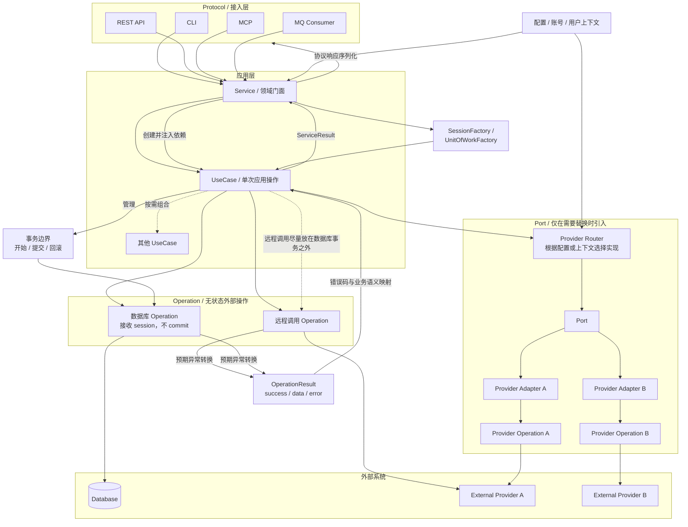

# Architecture conventions

This document defines a lightweight layered architecture. Do not introduce ports, repositories, or other abstractions solely to match an architectural diagram; add them when a concrete requirement justifies them.

## Dependency direction

```text
Protocol → Service → UseCase → Operation / Port
```



## Folder organization

Keep the top-level structure small. Create optional directories only when the corresponding abstraction is actually used.

```text
project_root/
├── src/
│   ├── protocols/          # CLI、REST、MCP、MQ 等接入适配器
│   │   └── cli/
│   ├── services/           # 对外门面、依赖所有权与装配
│   ├── use_cases/          # 单次应用操作及业务流程编排
│   ├── operations/         # 无状态第三方调用和数据库操作
│   ├── ports/              # 可选：需要替换的外部能力接口
│   ├── adapters/           # 可选：Port 的具体实现与 Provider 适配
│   ├── models/             # Result、Error 和共享数据结构
│   └── config.py           # 配置模型与加载
└── tests/
    ├── services/
    ├── use_cases/
    └── operations/
```

The names `entrypoints` and `interfaces` may replace `protocols` when they better describe the application. The dependency rules matter more than the directory names.

## Protocol

Protocols are adapters such as CLI, REST API, MCP, and MQ Consumer.

- Deserialize and validate external input, invoke the appropriate Service, and serialize its result into the protocol response.
- Handle authentication and protocol-level errors.
- Do not implement business workflows or call UseCases and Operations directly.

A Protocol owns transport-specific parsing and rendering. Configuration is loaded at the composition boundary and passed to the Service:

```python
@click.command()
@click.option("--value", required=True)
def execute_command(value: str) -> None:
    config = load_config()
    service = ApplicationService.from_config(config)
    result = asyncio.run(service.execute(ExecuteInput(value=value)))

    if not result.success:
        raise click.ClickException(result.error.message)
    click.echo(json.dumps(result.data))
```

Other Protocols follow the same shape: parse their own request format, call the Service, and map `ServiceResult` to their own response or error format.

## Service

A Service is the public facade for a domain or a group of related application capabilities.

- Expose multiple related operations and group their UseCases.
- Own the configuration required by those UseCases.
- Own connection factories and other shared dependencies.
- Construct UseCases and supply their configuration or dependencies; keep public Service methods thin, normally delegating to a UseCase.
- Do not implement third-party API calls or own database transaction boundaries.

Each layer owns its configuration contract. The Service converts its own configuration into the configuration required by each UseCase instead of passing a broad application-wide configuration object through every layer.

```python
class ApplicationService:
    def __init__(
        self,
        config: ApplicationServiceConfig,
        execute_action: BaseUseCase,
        query_status: BaseUseCase,
    ):
        self.config = config
        self._execute_action = execute_action
        self._query_status = query_status

    @classmethod
    def from_config(cls, config: ApplicationServiceConfig):
        return cls(
            config=config,
            execute_action=ExecuteActionUseCase(config.execute_action),
            query_status=QueryStatusUseCase(config.query_status),
        )

    async def execute(self, request: ExecuteInput) -> ServiceResult:
        return await self._execute_action.run(request)

    async def status(self, request: StatusInput) -> ServiceResult:
        return await self._query_status.run(request)
```

This example constructs UseCases directly inside `ApplicationService.from_config()` because they are concrete application dependencies. A dependency-injection container is not required.

## UseCase

A UseCase encapsulates one complete application action behind a standard `run()` method.

- Inherit `BaseUseCase`; the base class implements `run()` and delegates application logic to the subclass's `_run()` implementation.
- Own business rules, workflow orchestration, and the mapping of lower-level errors to public business errors.
- Call concrete Operations directly. Operations are not injected or abstracted.
- Accept the UseCase's own configuration through the constructor. Also accept other UseCases, SessionFactories, or Ports only when composition, transactions, or replaceable external capabilities require them.
- Own application policies such as retries and compensation.
- Own database transaction boundaries.
- Do not read global configuration, locate Services, or depend on Protocol frameworks.
- Prefer typed input and output models over internal `dict[str, Any]` contracts. Protocol adapters handle conversion to and from transport representations.

Services and composed UseCases depend on the `BaseUseCase` abstraction rather than concrete UseCase types. The base `run()` method provides consistent timing and exception-to-Result conversion:

```python
class BaseUseCase(ABC):
    async def run(self, inputs) -> ServiceResult:
        started = time.perf_counter()
        try:
            result = await self._run(inputs)
        except Exception as exc:
            result = ServiceResult.from_error("unknown", str(exc), exc)

        result.duration_seconds = time.perf_counter() - started
        return result

    @abstractmethod
    async def _run(self, inputs) -> ServiceResult:
        ...
```

This is the UseCase's public error boundary: a throwing Operation may be called directly, and an uncaught exception becomes a ServiceResult with the default `unknown` code. Log the original exception for diagnostics. Do not use this default code for special routing; UseCases that need specific responses must catch or map expected errors explicitly.

### Basic UseCase example

The Operation below is the concrete, stateless third-party call defined in the Operation section, not an interface or injected adapter. This example uses its Result-returning variant and maps only explicitly recognized error codes:

```python
from operations.remote import call_remote_api_result


class ExecuteActionUseCase(BaseUseCase):
    def __init__(self, config: ExecuteActionConfig):
        self._config = config

    async def _run(self, inputs: ExecuteInput) -> ServiceResult:
        result = await call_remote_api_result(
            token=self._config.token,
            payload={"value": inputs.value},
            timeout_seconds=self._config.timeout_seconds,
        )
        if not result.success:
            if result.error.code == "error_a":
                return ServiceResult.from_error("action_rejected", result.error.message)
            if result.error.code == "error_b":
                return ServiceResult.from_error("action_unavailable", result.error.message)
            return ServiceResult.from_error("action_failed", "The action could not be completed")

        return ServiceResult(success=True, data={"value": result.data})
```

A UseCase may instead call the original throwing Operation and let `BaseUseCase.run()` convert an otherwise unhandled exception into the default error Result.

Tests may monkeypatch the concrete Operation or third-party SDK. Operations are suitable patch targets because they are deliberately thin wrappers around HTTP or other protocols: their parameters and responses are stable, their remote-call details are hidden, and their simplicity makes disruptive refactoring unlikely. Do not introduce an Operation interface solely for testing. Avoid patching internal helper functions or other internal objects whose structure may change during refactoring.

When multiple providers require replacement, the Service owns the selected Port and supplies it to the relevant UseCase. A test Port may then be supplied through the Service. Until that requirement exists, call concrete Operations directly.

### UseCase composition example

A parent UseCase may compose other UseCases when each child represents a complete, independently valid application action and no shared database transaction is required. Composed UseCases are constructor dependencies:

```python
class CompositeUseCase(BaseUseCase):
    def __init__(self, first: BaseUseCase, second: BaseUseCase):
        self._first = first
        self._second = second

    async def _run(self, inputs: CompositeInput) -> ServiceResult:
        first_result = await self._first.run(inputs.first)
        if not first_result.success:
            return ServiceResult(
                success=False,
                error=first_result.error,
            )

        return await self._second.run(
            SecondInput(value=first_result.data["value"])
        )
```

The steps inside a transaction are database Operations or internal steps composed from database Operations. They receive the current session and never commit independently.

To compose multiple transactional UseCases atomically, each child exposes an internal `execute_in_transaction(session, inputs)` method. Its public `run()` may use that same method for standalone execution, but the parent must not call the child's public `run()`, because that would create an independent transaction. The outermost composite UseCase owns the shared session and performs the only commit:

```python
class CompositeTransactionalUseCase(BaseUseCase):
    def __init__(
        self,
        config: CompositeTransactionalConfig,
        session_factory,
        first: FirstTransactionalUseCase,
        second: SecondTransactionalUseCase,
    ):
        self._config = config
        self._session_factory = session_factory
        self._first = first
        self._second = second

    async def _run(self, inputs: CompositeInput) -> ServiceResult:
        async with self._session_factory() as session:
            try:
                first = await self._first.execute_in_transaction(session, inputs.first)
                second = await self._second.execute_in_transaction(session, first)
                await session.commit()
                return ServiceResult(success=True, data=second)
            except SQLAlchemyError as exc:
                await session.rollback()
                return ServiceResult.from_error("database_error", str(exc), exc)
```

Each child's `execute_in_transaction()` calls its database Operations and returns an ordinary value. Its standalone `_run()` may open a session, call the same method, and commit. This provides both independent execution and atomic composition without nested commits.

UseCase composition means object composition and dependency injection; it does not require the GoF Composite pattern.

## Operation

Operations are concrete, stateless functions for third-party API, HTTP, SDK, or database calls. They abstract away transport and SDK details; they are not abstract interfaces and do not require dependency injection.

### Third-party Operations

- Accept every value needed for the call, including keys and tokens, as explicit parameters.
- Keep fixed endpoint URLs inside the Operation. Do not require callers to pass endpoints that are part of the provider's protocol definition.
- Do not read configuration, select users or accounts, choose providers, or manage connection state.
- Hide HTTP and SDK details from callers.
- Leave credential, account, connection, and provider lifecycle management to upper layers.
- Return ordinary values and throw exceptions by default. Do not make every Operation return `OperationResult` directly.
- Expose a Result-returning variant through a decorator when the caller prefers explicit error handling. An Operation may provide only a Result-returning form when that is clearly more appropriate, but the throwing form plus derived Result variant is preferred.

```python
_REMOTE_ENDPOINT = "https://provider.example/api/action"


async def call_remote_api(
    *,
    token: str,
    payload: dict,
    timeout_seconds: float,
) -> dict:
    async with httpx.AsyncClient(timeout=timeout_seconds) as client:
        response = await client.post(
            _REMOTE_ENDPOINT,
            headers={"Authorization": f"Bearer {token}"},
            json=payload,
        )
    response.raise_for_status()
    return response.json()


call_remote_api_result = as_operation_result(
    call_remote_api,
    map_error=map_remote_error,
)
```

Callers may choose either form. The throwing form avoids repetitive success checks and lets exceptions propagate naturally. The Result form supports explicit error-code mapping. The decorator accepts an exception mapper so each boundary can assign stable error codes.

### Database Operations

- Accept the current database session as a parameter.
- Execute database reads or writes without opening or committing a transaction themselves.
- Return ordinary values and throw ORM exceptions by default, following the same rule as third-party Operations.
- Name Operations after domain capabilities using `create_<entity>`, `delete_<entity>`, `query_<entity>`, or `update_<entity>` rather than SQL-oriented names such as `insert_record`.

```python
async def create_entity(session: AsyncSession, values: dict) -> dict:
    session.add(Entity(**values))
    await session.flush()
    return values
```

## OperationResult and error conversion

The derived Result-returning variant contains `success`, `data`, and `error`. Errors contain `code`, `message`, and `exception`. `Error` is neither a Python keyword nor a built-in name, so it does not create a language-level conflict; use a more specific name only when local imports make the generic name unclear.

```python
@dataclass
class Error:
    code: str
    message: str
    exception: Exception | None = None


@dataclass
class OperationResult:
    success: bool
    data: Any = None
    error: Error | None = None

    @classmethod
    def from_error(cls, code: str, message: str, exception: Exception | None = None):
        return cls(
            success=False,
            error=Error(code=code, message=message, exception=exception),
        )
```

The decorator converts successful return values into successful Results. Its mapper returns an `Error` for expected exceptions and returns `None` for exceptions that must continue to propagate:

```python
def as_operation_result(func, *, map_error):
    @wraps(func)
    async def wrapper(*args, **kwargs):
        try:
            data = await func(*args, **kwargs)
            return OperationResult(success=True, data=data)
        except Exception as exc:
            error = map_error(exc)
            if error is None:
                raise
            return OperationResult(success=False, error=error)

    return wrapper


def map_remote_error(exc: Exception) -> Error | None:
    if isinstance(exc, httpx.HTTPError):
        return Error(code="unknown", message=str(exc), exception=exc)
    if isinstance(exc, ValueError):
        return Error(code="invalid_response", message=str(exc), exception=exc)
    return None
```

Do not catch `BaseException` or cancellation. Catching `Exception` in the generic decorator is safe only because unmapped exceptions are immediately re-raised; programming defects are not converted into normal failures.

### Error-code branching

Upper layers must branch only on specific, stable error codes they explicitly handle. They must not use `unknown` as a control-flow condition.

Incorrect:

```python
if error.code == "unknown":
    return route_a()
if error.code != "unknown":
    return route_b()
```

Correct:

```python
if error.code == "error_a":
    return route_a()
if error.code == "error_b":
    return route_b()
return default_route()
```

The default route handles `unknown`, unrecognized codes, and codes introduced later. Refining an error from `unknown` to a specific code therefore does not move callers from one special branch to another; both remain on the default route until a caller intentionally handles the new code.

Keep original exceptions for internal diagnostics. Do not expose them in external protocol responses. Retry decisions belong to the upper-level UseCase; a `retryable` field is not required in `Error`.

## Database session and transaction management

### SessionFactory is the default; UnitOfWork is optional

- `SessionFactory` creates ORM sessions. Depend on the concrete ORM's factory directly; do not abstract it merely to allow replacing the ORM.
- The UseCase uses the session directly and owns commit and rollback.
- `UnitOfWork` is an optional wrapper around a session that provides an application-level transaction boundary.
- `UnitOfWorkFactory` creates UnitOfWork instances and commonly contains a SessionFactory.
- Do not introduce a custom UnitOfWork by default. Add it only when it removes repeated transaction lifecycle code or solves a concrete coordination problem.

### Direct SessionFactory example

The database Operation returns an ordinary value. Expected ORM failures are converted into a ServiceResult after rollback; unexpected programming defects continue to propagate.

```python
session_factory = async_sessionmaker(engine, expire_on_commit=False)


class DirectSessionUseCase(BaseUseCase):
    def __init__(self, config: DirectSessionConfig, session_factory):
        self._config = config
        self._session_factory = session_factory

    async def _run(self, inputs: ExecuteInput) -> ServiceResult:
        async with self._session_factory() as session:
            try:
                data = await create_entity(session, inputs.values)
                await session.commit()
                return ServiceResult(success=True, data=data)
            except SQLAlchemyError as exc:
                await session.rollback()
                return ServiceResult.from_error("database_error", str(exc), exc)
```

### Optional UnitOfWork and UnitOfWorkFactory example

This is an optional pattern, not a required abstraction. Prefer the concrete ORM SessionFactory unless a UnitOfWork solves a demonstrated problem.

```python
class UnitOfWork:
    def __init__(self, session_factory):
        self._session_factory = session_factory
        self.session: AsyncSession | None = None

    async def __aenter__(self):
        self.session = self._session_factory()
        return self

    async def __aexit__(self, exc_type, exc, traceback):
        if exc_type is not None:
            await self.rollback()
        await self.session.close()

    async def commit(self):
        await self.session.commit()

    async def rollback(self):
        await self.session.rollback()


class UnitOfWorkFactory:
    def __init__(self, session_factory):
        self._session_factory = session_factory

    def __call__(self) -> UnitOfWork:
        return UnitOfWork(self._session_factory)
```

When using this UnitOfWork, an early return without `commit()` leaves the transaction uncommitted; `session.close()` rolls it back. `__aexit__` rolls back exceptions explicitly. Production implementations may also track transaction state to make accidental omission of commit easier to diagnose.

A Service owns the concrete ORM SessionFactory and supplies it to the UseCase. Only construct a UnitOfWorkFactory when the optional UnitOfWork pattern is adopted:

```python
session_factory = async_sessionmaker(engine, expire_on_commit=False)
use_case = DirectSessionUseCase(DirectSessionConfig(), session_factory)

# Optional alternative:
uow_factory = UnitOfWorkFactory(session_factory)
```

### Consistency rules

- UseCases decide when transactions begin, commit, and roll back.
- Database Operations participate in the current transaction through the supplied session and never commit independently.
- Reusable internal business steps receive a session and do not own transactions.
- Independent UseCases do not open nested transactions by default.
- Use database constraints such as uniqueness and foreign keys as the final consistency safeguard.
- Keep remote calls outside database transactions whenever possible.
- Coordinate databases and external systems through local state, idempotency keys, and compensation workflows; a local database transaction cannot make a remote system and the database atomic together.

## Port

Do not create a Port merely because a third-party provider is introduced. Call a concrete Operation directly until multiple implementations, a real replacement requirement, or a stable fake makes an interface useful.

When introduced:

- Keep the Port limited to the capability callers actually need; do not mirror an entire third-party SDK.
- Keep existing stateless provider functions and place adapters between them and the Port.
- A Port defines the capability only. It does not select implementations.
- Provider selection based on configuration or context belongs in a Router, Dispatcher, or Service assembly code.

## Summary

Services group related application operations and own dependencies. UseCases own application workflows and transactions. Operations perform stateless external calls. Ports are introduced only when replacement or multiple implementations provide concrete value.
