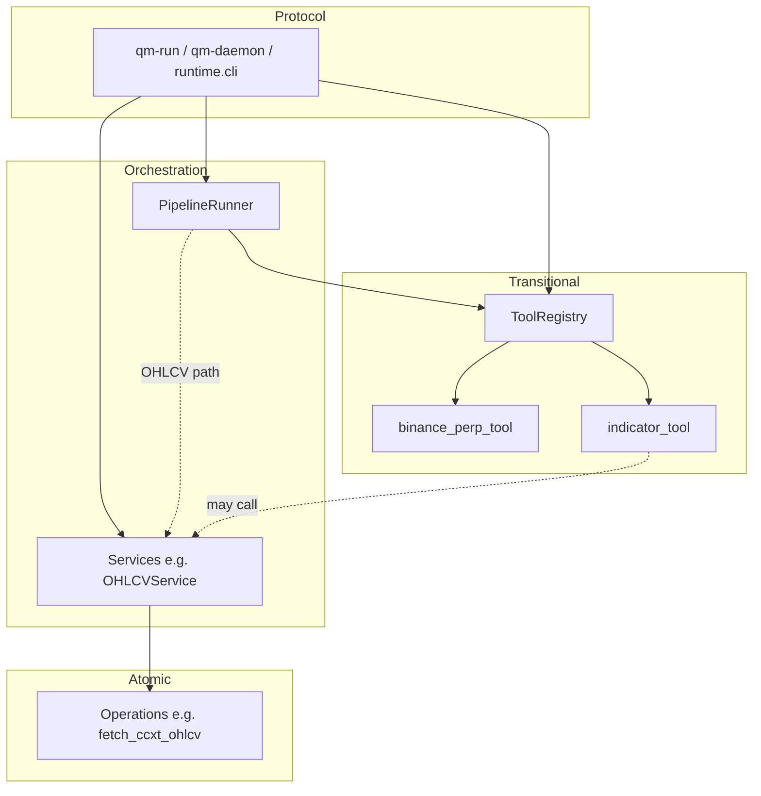

# Refactor & Cleanup Plan — Package Layout, Tools → Services, Docker Dev

> Date: 2026-11-04  
> Status: planning note (not an implementation spec)  
> Scope: align the repo with a thinner layout, move business logic toward Operations/Services, and make lint/test reproducible via Docker  
> Related: [`docs/conventions/architecture.md`](../conventions/architecture.md), [`docs/conventions/testing.md`](../conventions/testing.md)

## 1. Why

The tree currently mixes:

- A **tool-centric** runtime that still works
- A **target** Operation / Service layer that barely exists
- Many **empty placeholder packages** (`tools/account`, `skills/trading`, `runtime/api`, …)
- Parallel contract systems (**JSON Schema files** + **Pydantic** models)
- Agent-facing **`skills/`** docs that are unused in day-to-day development
- Host-dependent tooling (`ruff` not installed in the project env; no container story)

This note sequences cleanup so we can ship small, reviewable steps instead of one big-bang rewrite.

## 2. Goals

| # | Goal | Outcome |
|---|------|---------|
| G1 | Drop JSON Schema package | Manifests and results validated only via **Pydantic** |
| G2 | Remove `skills/` | Single agent entry remains root `AGENT_GUIDE.md` → `docs/conventions/` |
| G3 | Delete empty folders | No unused package stubs |
| G4 | Collapse `tools/` into `runtime/` | Tools live under `runtime/tools/`; only retained tools stay |
| G5 | Delete smoke/demo tools | No `echo_tool` / `demo_data_tool` |
| G6 | Extract `ohlcv_tool` now | Logic lands in `runtime/operations/` + `runtime/services/` |
| G7 | Short CLI names | `qm-daemon`, `qm-run` (old names removed or thin aliases — prefer remove) |
| G8 | Tests match new surface | Delete or rewrite cases that target removed modules / violate testing conventions |
| G9 | Reproducible lint/dev | Dockerfile (+ compose) so `ruff` / `pytest` / ta-lib install the same everywhere |

**Explicitly deferred (next discussion):** how to peel `binance_perp_tool` and `indicator_tool` into Operations/Services. This plan **keeps those two as tools** under `runtime/tools/` until that design is agreed.

## 3. Non-goals (this plan)

- Full pipeline migration from `tool:` steps to `service:` steps (architecture target); only what OHLCV extraction forces
- REST API (`runtime/api`) — stay deleted/absent until needed
- Implementing empty domains (news, risk, research, visualization, approval, …)
- Changing exchange credentials layout in `config.yaml`
- Rewriting the market-intelligence research bot

## 4. Target tree (after cleanup)

```
.
├── AGENT_GUIDE.md              # short pointer → docs/conventions/
├── README.md
├── pyproject.toml
├── config.yaml.example
├── Dockerfile                  # NEW
├── docker-compose.yml          # NEW (dev: lint / test / shell)
├── pipelines/
│   └── …                       # no echo-based smoke; real market or service-backed examples
├── runtime/
│   ├── daemon.py
│   ├── cli.py
│   ├── bootstrap.py
│   ├── config_loader.py
│   ├── pipeline_runner/
│   ├── scheduler/
│   ├── state_store/
│   ├── event_bus/
│   ├── notifier/               # channel implementations (not a tool)
│   ├── operations/             # atomic I/O / pure steps (OHLCV providers land here first)
│   ├── services/               # orchestration + Pydantic I/O (OHLCVService first)
│   └── tools/                  # transitional ToolRegistry surface
│       ├── base/
│       ├── execution/binance_perp_tool.py
│       └── market_data/indicator_tool.py
├── docs/
├── tests/
├── artifacts/                  # runtime output (gitignored as today)
└── data/                       # runtime DB
```

**Removed entirely:** `schemas/`, `skills/`, top-level `tools/`, empty stubs under runtime/tools domains, demo tools, `notify_tool`, `parallel_tool` (unless a later decision restores them as Services).



## 5. Work packages (ordered)

Do these in order; each package should leave `pytest -m unit` green inside Docker.

### WP0 — Inventory freeze (doc only; this file)

- Agree retained surface: **tools** = `binance_perp_tool`, `indicator_tool`; **service** = OHLCV; **infra** = notifier channels without `notify_tool`.
- Agree CLI rename: replace entry points (no long-term dual names).

### WP1 — Delete unused packages and empty folders

Delete (or stop packaging) with import/doc updates in the same change:

| Path | Action |
|------|--------|
| `skills/` | delete |
| Empty `tools/*` stubs | delete with tools move (WP3) |
| `runtime/api/`, `runtime/memory/` if still empty | delete |
| `tools/account`, `approval`, `equities_data`, `memory`, `news`, `research`, `risk`, `visualization` | delete |
| Root `AGENT_GUIDE.md` | rewrite to point at `docs/conventions/` only |

Update [`pyproject.toml`](../../pyproject.toml) `packages.find` / `package-data` to drop `skills*`, `schemas*`.

### WP2 — Remove `schemas/` + `jsonschema`

Today [`runtime/pipeline_runner/runner.py`](../../runtime/pipeline_runner/runner.py) loads `schemas/pipeline_manifest.schema.json` and calls `jsonschema.validate`.

Replacement:

1. Add Pydantic models for pipeline manifests (e.g. `runtime/pipeline_runner/manifest.py`: `PipelineManifest`, `StageSpec`, optional `TriggerSpec`).
2. `_load_manifest` → `yaml.safe_load` then `PipelineManifest.model_validate(...)`.
3. Drop dependency `jsonschema` from `pyproject.toml`.
4. Delete `schemas/` and `tests/contracts/test_*_schema.py` (or rewrite as Pydantic model tests under `tests/runtime/`).
5. Ensure `Signal` / tool result contracts already owned by Pydantic / SQLAlchemy models remain the source of truth (see note in `runtime/state_store/models.py`).

### WP3 — Move tools under `runtime/tools/` and cull

1. Physically move retained code:
   - `tools/base/` → `runtime/tools/base/`
   - `tools/execution/binance_perp_tool.py` → `runtime/tools/execution/`
   - `tools/market_data/indicator_tool.py` → `runtime/tools/market_data/`
2. Delete not retained:
   - `echo_tool`, `demo_data_tool`
   - `notify_tool` (keep `runtime/notifier/` channels; bootstrap stops registering a notify tool)
   - `parallel_tool`
   - `ohlcv_tool` **as a tool file** after WP4 extracts it (order: extract first or move-then-extract in one PR)
3. Fix imports: `tools.*` → `runtime.tools.*` everywhere (bootstrap, CLI, indicator internals, tests, docs).
4. Discovery: `ToolRegistry.discover` package root becomes `runtime.tools` (or a dedicated subpackage).
5. Remove top-level `tools/` package from setuptools includes.

**Pipelines:** replace / delete [`pipelines/hello_pipeline.yaml`](../../pipelines/hello_pipeline.yaml) (echo-based). Keep or rewrite [`pipelines/market_open_review.yaml`](../../pipelines/market_open_review.yaml) to call the OHLCV **service** once runner supports it, or temporarily a thin adapter — decide in WP4.

### WP4 — Extract OHLCV into Operations / Services (do now)

Current logic lives in [`tools/market_data/ohlcv_tool.py`](../../tools/market_data/ohlcv_tool.py): input models, provider selection (ccxt / yfinance / tushare / akshare), CSV artifact packing.

Proposed split (concrete default for discussion confirmation):

| Layer | Suggested units | Responsibility |
|-------|-----------------|----------------|
| Operation | `fetch_ccxt_ohlcv`, `fetch_yfinance_ohlcv`, `fetch_tushare_ohlcv`, `fetch_akshare_ohlcv` | One provider call → DataFrame (or rows); no artifact I/O |
| Operation | `ohlcv_to_csv` / write-artifact helper if needed | Pure transform or single filesystem write |
| Service | `OHLCVService` | Validate `OHLCVInput`, pick provider from market/source + config, call one Operation, persist artifact via StateStore/runner contract, return `OHLCVOutput` |

Protocol:

- CLI: prefer `python -m runtime.cli service ohlcv ...` **or** keep a temporary `tool ohlcv_tool` shim that only delegates to `OHLCVService` until pipelines speak `service:`.
- Pipeline: prefer adding `service:` stage support in `PipelineRunner` for OHLCV only; if that is too large for one PR, ship Service + CLI first, then wire pipeline in a follow-up.

`indicator_tool` today imports `OHLCVTool` for inline fetch — after extraction it must call **`OHLCVService`** (or a shared Operation), not a deleted tool class.

**Out of scope for WP4:** redesigning binance / indicator internals (see §7).

### WP5 — CLI rename

In [`pyproject.toml`](../../pyproject.toml) `[project.scripts]`:

| Old | New |
|-----|-----|
| `quantmaster-daemon` | `qm-daemon` |
| `quantmaster-run` | `qm-run` |

Update README, AGENT_GUIDE, tool docs, and any scripts. Do **not** keep the old names unless a short deprecation is explicitly requested later.

### WP6 — Tests: delete or rewrite

Delete tests whose subjects are gone:

- `tests/tools/test_echo_tool.py`
- `tests/tools/test_demo_data_tool.py`
- `tests/tools/test_notify_tool.py`
- `tests/tools/test_parallel_tool.py`
- `tests/tools/test_ohlcv_tool.py` → replace with Operation unit tests + `OHLCVService` / CLI tests
- `tests/contracts/*` tied to JSON Schema files
- Echo-based cases in `tests/runtime/test_pipeline_runner.py`, `test_bootstrap.py`, `tests/runtime/services/test_pipeline_service.py`, `tests/integration/test_milestone2_pipelines.py`

Rewrite retained coverage to follow [`docs/conventions/testing.md`](../conventions/testing.md):

- Drive through **CLI** or **Service** public I/O
- Patch only external SDKs (`ccxt`, HTTP, etc.)
- No monkeypatch of internal helpers / DB layer
- Markers: `unit` / `integration` as today

Keep and adapt: `test_binance_perp_tool.py`, `test_indicator_tool.py` (import paths + OHLCV dependency).

Also delete or slim `runtime/operations/echo.py`, `runtime/services/echo_service.py`, and their tests once echo is gone.

### WP7 — Docker for reproducible lint / test / dev

Problem: `ruff` is configured in `pyproject.toml` but **not** listed under `[project.optional-dependencies]`; host installs diverge; `ta-lib` is system-sensitive.

Deliverables:

1. **`Dockerfile`** (multi-stage or single dev image):
   - Base: Python 3.12
   - Install system deps for **TA-Lib** (and build tools)
   - `pip install -e ".[dev]"` with **`ruff` added to `dev` extras**
2. **`docker-compose.yml`** services, e.g.:
   - `shell` — interactive workspace mount
   - `test` — `pytest -m unit` / full suite
   - `lint` — `ruff check runtime tests`
3. README section: “Develop inside Docker” with copy-paste commands
4. Optional later: CI job that only runs the same compose targets

Default stance: container is for **dev/lint/test** first; production daemon image can wait.

## 6. Suggested PR sequence

| PR | Contents | Risk |
|----|----------|------|
| 1 | WP1 + WP5 (delete skills/empties + rename CLI + docs pointers) | Low |
| 2 | WP2 (Pydantic manifests, drop schemas/jsonschema) | Medium |
| 3 | WP7 (Dockerfile, compose, add ruff to dev) | Low |
| 4 | WP4 (OHLCV Operations/Service) + pipeline/CLI wiring | Medium–High |
| 5 | WP3 (move tools under runtime, cull demo/notify/parallel) | Medium |
| 6 | WP6 (test purge/rewrite) — can ride with PRs 4–5 | Medium |

PR 3 can land early so all later PRs are verified in-container. PR 4 before or merged with PR 5 avoids a window where `ohlcv_tool` still lives at the old path.

## 7. Open discussion (next conversation)

Do **not** implement until agreed:

1. **`binance_perp_tool` → Operations/Services**  
   Candidate split: read ops (`balance`, `positions`, `open_orders`) vs write ops (`create_order`, `cancel_order`, leverage/margin/mode) behind an `ExecutionService` with dry_run policy at Service boundary.

2. **`indicator_tool` → Operations/Services**  
   Candidate split: pure indicator/pattern Operations (ta-lib) vs Service that loads OHLCV artifact/CSV and writes indicator artifacts.

3. **Pipeline stage vocabulary**  
   Keep dual `tool:` + `service:` during transition, or migrate manifests in one cut once OHLCV is a Service.

4. **Notifier without `notify_tool`**  
   Call `CompositeNotifier` only from Services / runner hooks, or add `NotifyService` later — not a ToolRegistry entry.

5. **Smoke pipeline** after echo removal  
   Minimal cron/example using `OHLCVService` vs delete smoke until a real strategy pipeline exists.

## 8. Acceptance checklist

- [ ] No `schemas/`, no `skills/`, no top-level `tools/`
- [ ] No empty domain packages left in-tree
- [ ] `qm-daemon` / `qm-run` work; old script names gone
- [ ] OHLCV reachable via Service (and pipeline or documented CLI)
- [ ] Registry lists only `binance_perp_tool` and `indicator_tool` (plus any intentional shims)
- [ ] `docker compose run lint` and `docker compose run test` pass on a clean machine
- [ ] Unit tests follow entrypoint + SDK-patch rules; deleted-tool tests are gone
- [ ] README + AGENT_GUIDE + architecture cross-links match the new tree

## 9. Doc updates required when implementing

- Root [`README.md`](../../README.md) layout + CLI + tool list
- [`AGENT_GUIDE.md`](../../AGENT_GUIDE.md)
- [`docs/conventions/architecture.md`](../conventions/architecture.md) (current vs target; remove skills pointers)
- [`docs/tools/indicator_tool.md`](../tools/indicator_tool.md), [`binance_perp_tool.md`](../tools/binance_perp_tool.md) import/CLI paths
- New `docs/tools/` or `docs/services/` page for OHLCVService
- Research notes may keep historical `ohlcv_tool` wording; add a one-line “superseded by OHLCVService” where confusing
